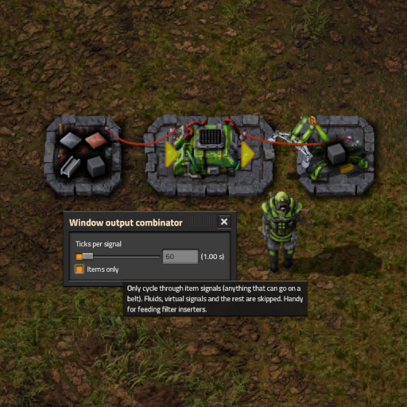

# WePlay: Window Output Combinator Reborn



A Factorio 2.1 mod that adds the **Window output combinator**: it reads every signal on its input wires and outputs them **one at a time**, holding each one for a number of ticks you choose before moving on to the next.

It's a remake of the classic "window output" combinator idea, rebuilt for Factorio 2.1.

---

## What it's for

A normal combinator passes on all of its signals at once. Sometimes you only want **one** of them at a time:

- **Filter inserters / sorters**: feed a list of items in, and the inserter's filter steps through them one by one.
- **Requesters and train stops**: rotate through a set of requests instead of asking for everything at once.
- **Displays and lamps**: cycle through a list of signals on a display panel.
- **Round-robin logic**: anywhere you need to "visit" each signal in a set in turn.

## Features

- Cycles through **all input signals** (red and green wires merged).
- **Configurable interval**: 1 tick up to 216,000 ticks (one hour) per signal.
- **Live counts**: while a signal is being shown, its output value follows the input in real time.
- **Items only** mode: skips fluids, virtual signals and everything else, so only item signals come out. This is handy for filter inserters.
- **Quality aware**: each quality of an item counts as a separate signal.
- Settings survive **copy/paste** (Shift+right-click / Shift+left-click) and **blueprints**.
- Works when built by hand, by robots, on space platforms and by other mods' scripts.
- Outputs nothing when it has no power.
- Custom sprite with a lime-green tinted icon.

## Getting it in game

**Unlocked by:** Circuit network technology

**Recipe:** 5 × Copper cable + 5 × Electronic circuit → 1 × Window output combinator

## Usage

1. Place the combinator like an arithmetic combinator. Input goes on one side, output on the other.
2. Wire your signals into the **input** side (red, green or both).
3. Wire the **output** side to whatever should receive the rotating signal.
4. Click the combinator to open its window:
   - **Ticks per signal**: use the slider (1–600) or type any value from 1 to 216000 in the box. The time in seconds is shown next to it (60 ticks = 1 s).
   - **Items only**: tick this to skip anything that isn't an item.

### Cycle order

Signals are sorted by `type/name/quality` text, so the order is stable and predictable rather than depending on how the wires happen to report them. In practice that means:

- fluids come before items, and items come before virtual signals
- within a type, signals go alphabetically by internal name (for example `copper-plate` before `iron-plate`)
- different qualities of the same item sit next to each other

When the end of the list is reached, it wraps back to the start. If the signal currently shown disappears from the input, the combinator moves straight on to the next one without waiting for the timer.

### Mod settings

| Setting | Scope | Default | Description |
|---|---|---|---|
| Default ticks per signal | Map (runtime-global) | 60 | Interval given to newly built combinators that don't come from a blueprint. |

---

## How the code works

The mod is small: about 100 lines of prototype code and 350 lines of runtime script.

```
WePlayWindowOutputCombinator/
├── info.json              Mod metadata (Factorio 2.1, depends on base >= 2.1)
├── settings.lua           The "default ticks per signal" map setting
├── data.lua               Prototypes: entity, hidden helper, item, recipe, tech unlock
├── control.lua            Runtime logic: build/remove, tick loop, GUI, blueprints
├── locale/en/locale.cfg   English strings
├── graphics/
│   └── window-output-combinator.png   4-direction sprite sheet (576×124)
├── thumbnail.png
└── changelog.txt
```

### The two-entity trick (`data.lua`)

Factorio has no built-in combinator that can output an arbitrary signal chosen by script. So the mod pairs two entities:

1. **The visible combinator** (`wp-window-output-combinator`) is a deep copy of the vanilla **arithmetic combinator**. It is only used for its look, its input/output wire connectors, its power draw and its "open" behaviour. Its own arithmetic is kept blank so it never outputs anything itself. The arithmetic operator symbols are swapped for empty sprites so they don't draw over the custom artwork. The custom sprite sheet holds four 144×124 frames (N, E, S, W).

2. **The hidden helper** (`window-output-combinator-output`) is a deep copy of the **constant combinator**, made invisible and out of reach:
   - `hidden`, not on the map, not blueprintable, not deconstructable, not selectable, no copy/paste
   - zero-size collision and selection boxes and an empty collision mask, so it can sit on the same tile as the visible combinator
   - empty sprites, no wires drawn, no corpse or explosion

   This helper is where the output signal actually comes from.

The data stage also creates the item and recipe and adds the recipe unlock to the `circuit-network` technology.

### Building (`on_built`)

When a Window output combinator is placed (by a player, a robot, a space platform, `script_raised_built` or `script_raised_revive`; all filtered to this entity name), the script:

1. **Blanks the arithmetic logic** by setting its parameters to just `{operation = "+"}` with no signals, so it outputs nothing.
2. **Creates the hidden helper** at the same position and makes it indestructible. It makes sure the helper has one logistic section to write into.
3. **Connects them with script-owned wires** (`defines.wire_origin.script`): the visible combinator's `combinator_output_red` → helper's `circuit_red`, and the same for green. Script wires don't show up and players can't cut them. Because the helper is now on the same circuit network as the combinator's output side, anything wired to that output sees the helper's signal.
4. **Picks its settings**: the map default interval, unless the build came from a blueprint whose tags hold `woc_interval` / `woc_items_only`.
5. **Saves a record** in `storage.combinators[unit_number]`:

   ```lua
   {
     entity     = <visible combinator>,
     output     = <hidden helper>,
     interval   = <ticks per signal>,
     items_only = <bool>,
     timer      = 0,   -- ticks left on the current signal
     index      = 0,   -- position in the sorted signal list
     shown_key  = nil, -- key of the signal being output (set later)
     shown_count= nil, -- value being output (set later)
   }
   ```

6. **Registers the entity** with `script.register_on_object_destroyed`, so the mod is told however it disappears.

### Removal (`on_destroyed`)

`on_object_destroyed` fires for mining, deconstruction, death and script destruction alike. The handler looks up the record by `useful_id` (the unit number), destroys the hidden helper and drops the record. As a backup, the tick loop also cleans up any record whose entity is no longer valid.

### The tick loop (`on_tick` → `update`)

Every tick, each combinator in storage goes through `update`:

1. **Power check.** If the entity status is `no_power`, clear the output and stop.
2. **Read inputs.** `entity.get_signals(combinator_input_red, combinator_input_green)` returns the merged input. Each signal gets a key of the form `type/name/quality` (for example `item/iron-plate/normal`). If *items only* is on, non-item signals are dropped. The list is then sorted by key.
3. **Empty input.** Reset `index` and `timer` and clear the output.
4. **Find the current signal.** If something is already being shown, look for its key in the new list. If found, keep its live count and update `index` to its new position. Signals can be added or removed around it without the rotation skipping.
5. **Advance when needed.** Decrease `timer`. If the timer has run out, *or* the shown signal is gone, step to the next index (wrapping with `index % n + 1`) and reset `timer` to `interval`.
6. **Write the output** with `set_output`.

### Writing the output (`set_output`)

The helper is a constant combinator, so output is one **logistic section slot**:

```lua
section.set_slot(1, {
  value = {type = ..., name = ..., quality = ..., comparator = "="},
  min = count,
})
```

To avoid making API calls every tick for nothing, the record caches `shown_key` and `shown_count`. The slot is only rewritten when the signal or its value actually changes. Clearing the output (`clear_slot(1)`) also only happens if something was being shown.

### GUI

Opening the combinator triggers `on_gui_opened`. The mod builds its own window in `player.gui.screen` and sets `player.opened` to it, which replaces the vanilla arithmetic combinator window. The window has:

- a draggable title bar with a close button
- a **slider** (1–600) and a **numeric text box** (1–216000) that stay in sync, plus a label showing the value in seconds
- the **Items only** checkbox

`storage.guis[player_index]` remembers which combinator each player has open. The handlers:

- `on_gui_value_changed` / `on_gui_text_changed` → `set_interval`, which clamps the value to 1–216000, saves it, cuts down the running timer if it's now longer than the new interval, and updates the *other* control (the slider stops at 600 even when the text box holds more).
- `on_gui_checked_state_changed` → toggles `items_only` and sets `timer = 0`, so the output jumps straight to a signal that passes the new filter.
- `on_gui_closed` / the close button → destroy the window and forget the mapping.

### Copy/paste and blueprints

- **`on_entity_settings_pasted`**: when pasting from one Window output combinator to another, the interval and items-only flag are copied. Whatever the source was, `blank_arithmetic` runs on the target afterwards, so pasting from a normal arithmetic combinator can't put real arithmetic into it.
- **`on_player_setup_blueprint`**: for each Window output combinator in the blueprint (works for both item blueprints and blueprint-library records), the script stores `woc_interval` and `woc_items_only` as **blueprint entity tags**. When the ghost is built, `on_built` reads those tags from `event.tags`.

The hidden helper is flagged `not-blueprintable`, so blueprints only ever carry the visible combinator. A fresh helper and fresh wires are made at build time.

### Storage layout

| Key | Maps | Purpose |
|---|---|---|
| `storage.combinators` | `unit_number → record` | All live combinators and their state |
| `storage.guis` | `player_index → unit_number` | Which combinator each player has open |

Both tables are set up in `on_init` and again in `on_configuration_changed`, so adding the mod to an existing save works.

### Performance notes

Each combinator reads and sorts its inputs once per tick, so the cost grows with the number of combinators × the number of input signals. That's fine for typical builds with a handful of combinators and short signal lists. The output caching keeps writes to the helper down to the moments when something actually changes.

---

## Known limitations

- **Cloning** (`on_entity_cloned`, for example from mods that copy areas) isn't handled. A cloned combinator gets no helper and won't output anything.

## Changelog

See [`changelog.txt`](changelog.txt).

- **0.0.2**: new sprite and thumbnail.
- **0.0.1**: first release.

## Credits

Made by **WePlay**.
